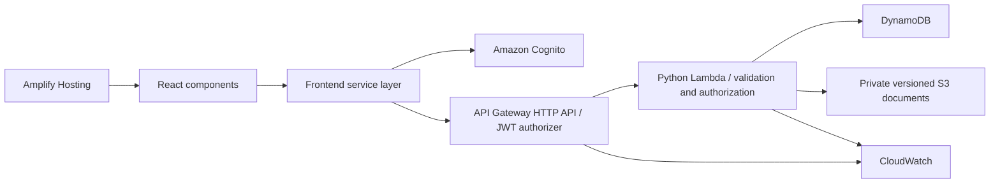

# ScholarRise backend foundation

## Specification and current status

The authoritative report, `D:\SIIT\Cloud Project\DES424 - Kickoff Report - Group 9.docx`, was reviewed on 14 November 2026, including its embedded system diagram. Its stack matches this foundation: React/JavaScript, Python Lambda, API Gateway, DynamoDB, Cognito, S3, Amplify Hosting, CloudWatch, VS Code, GitHub, Jira, and Playwright. SQL is listed as an additional programming language; the report explicitly identifies DynamoDB as the database. No relational database, FastAPI, or SNS has been introduced. No earlier PDF or technical plan was used. See [REPORT-ALIGNMENT.md](REPORT-ALIGNMENT.md) for requirement coverage and remaining gaps. Document content is treated as specification evidence, not as permission to deploy resources or execute embedded instructions.

**No AWS resources have been deployed or created, and AWS is not connected or verified.** Installing Python development dependencies does not create cloud resources.

## 1. What the existing app does

| Existing file | Current behavior | Backend destination |
| --- | --- | --- |
| `src/Portal.jsx` `loadStore` / provider | Entire demo store in `localStorage` under `scholarrise-platform-v1`; selected user ID in `sessionStorage` | Per-resource API calls; Cognito tokens, not a user ID, establish identity |
| `AuthDialog` | Local password hashing, student registration, demo university/admin role selection | Cognito sign-up, email confirmation, login and sign-out |
| `Profile`, `Overview`, `Recommendations` | Local profiles and rule-based matching | Users table and `/me/profile`, `/me/recommendations` |
| `Management` | Local ownership checks, edits, approval, user activation and counts | Server-side ownership, conditional writes and admin routes |
| `Applications` and card bookmarks | Local status, notes and saved IDs | Activity table, partitioned by signed-in Cognito subject |
| `Notifications` / `src/model.js` | Browser-open deadline checks and dismissed IDs | On-request reminders persisted in Notifications table |
| `src/data.js`, `src/thaiScholarships.js` | Browser seed/demo data and official-source summaries | Explicit admin-owned catalog import later; never automatic cloud writes |
| `src/main.jsx` | Local search/filtering, cards and detail dialog | Optional service-backed public discovery is implemented now |

The existing browser app remains the default. Existing storage keys, logo, styling, pages and dashboards are retained. There is no automatic migration of demo accounts or passwords into Cognito. Browser accounts and cloud accounts are separate identities; their records must not be silently merged.

The first backend implementation task now has a dedicated [backend quick-start README](../backend/README.md). It covers the scholarship data models, discovery repository, mocked boto3 tests and exact offline commands. The DynamoDB adapter preserves Decimal values on updates, and public scholarship responses use an explicit allowlist.

## 2. How the new pieces fit



API Gateway verifies the JWT signature before forwarding claims. Lambda additionally checks token use, expiry, issuer, app client ID, the live Users record, account activation and role. A browser-supplied role or owner ID is never accepted. The **Users table role is authoritative**, allowing immediate account disablement even for an unexpired JWT. Cognito groups mirror staff roles for management; they do not override the database. Do not create a Lambda Function URL or a second unprotected gateway integration.

The code uses one API Lambda with small modules and an independent Cognito post-confirmation Lambda. A single API Lambda is easier to learn for this project; route families can later be split for narrower execution roles without changing the frontend API contract.

## 3. DynamoDB tables and access patterns

All tables use string keys, on-demand billing, encryption and point-in-time recovery in the prepared template. Every mutable record has an integer `version`. Updates require the version returned by the last read; a stale write gets HTTP 409 rather than overwriting another person's changes.

| Table | Partition key | Sort key / indexes | Purpose and access |
| --- | --- | --- | --- |
| Users | `userId` = Cognito `sub` | none | Server-controlled `role`, `active`, staff `university`; student `profile`; own profile reads/updates, admin limited user listing |
| Scholarships | `id` | `StatusIndex`: `approvalStatus` + `id`; `OwnerIndex`: `ownerId` + `id` | Public approved discovery; university's own listings; admin moderation |
| Activity | `userId` | `recordKey` = `SAVED#<id>` or `APPLICATION#<id>` | Saved scholarship IDs and private application status/notes; query only caller's partition |
| Notifications | `userId` | `id` = `<scholarshipId>:<deadline>` | Idempotent deadline reminders with dismissal retained |
| Documents | `id` | none | Server-generated S3 key, owner, scholarship ID, status and approved object version |

Canonical scholarship fields are `studyLevels` (array of Bachelor's, Master's, PhD), `fundingType` (Fully Funded, Partially Funded, Tuition Waiver, Fixed Amount), `country`, `university`, `ownerId`, `published`, `approvalStatus`, `minGpa`, `deadline`, `description`, `eligibility`, `documents` (text checklist), and `applicationUrl`. `documentIds` links uploaded files; it is separate from the text checklist. A missing GPA or deadline is not invented.

Public discovery queries approved items and rereads primary records consistently to avoid exposing an item from a stale index after it is unpublished. Only `published=true AND approvalStatus=approved` is public. Country/university facets come from those same public records. Filters combine with AND; study level checks array membership; keywords are case insensitive. Responses have `items`, `total`, `nextOffset`, and `facets`.

**Scale limit:** this educational foundation reads the approved catalog before filtering and slicing responses. Admin counts use paginated table scans. This is appropriate only for a small project catalog. Before a large deployment, replace offset pagination/full-catalog evaluation with access-pattern-specific indexes/cursors and aggregate counters. DynamoDB has no built-in full-text search. No external search engine or SQL database has been substituted.

## 4. Files to understand first

| Path | Responsibility |
| --- | --- |
| `backend/scholarrise/handler.py` | Actual Lambda entry point; creates AWS clients only at runtime |
| `backend/scholarrise/app.py` | Routes, workflow rules, recommendations and in-app reminders |
| `backend/scholarrise/models.py` | Scholarship draft/public models and typed search filters |
| `backend/scholarrise/scholarships.py` | Scholarship discovery/detail repository operations |
| `backend/scholarrise/auth.py` | Trusted JWT context, live roles and scholarship ownership |
| `backend/scholarrise/validation.py` | Bounded field allowlists, levels, funding, GPA, dates and HTTPS URLs |
| `backend/scholarrise/repository.py` | DynamoDB adapter and matching in-memory test adapter |
| `backend/scholarrise/storage.py` | Five-minute S3 upload policies and authorized downloads |
| `backend/scholarrise/provision.py` | Confirmed self-registration creates only a student record |
| `backend/local_server.py` | Offline loopback-only development server; never configure as a cloud handler |
| `backend/provision_staff.py` | Explicit operator tool to provision a confirmed Cognito account as staff |
| `src/services/api.js` | Frontend HTTP methods, bearer tokens, errors and all endpoint methods |
| `src/services/cognito.js` | Public-client Cognito registration/confirmation/login/sign-out adapter |
| `src/services/discovery.js` | Demo/API discovery switch and paginated catalog loading |
| `infrastructure/template.json` | Reviewable AWS SAM infrastructure, not a deployed stack |
| `infrastructure/generate-template.cjs` | Regenerates the same template locally |
| `amplify.yml` | Amplify build configuration for the existing Vite `dist` output |

## 5. Run locally without AWS

Open the repository in VS Code. Use Python 3.13 and Node.js. If `python` is a Windows Store alias, use the actual Python executable path; this machine has `C:\Users\User\AppData\Local\Programs\Python\Python313\python.exe`. The existing portable Node remains under `.tools/node-v24.22.3-win-x64`.

The offline runner and Python domain tests require only Python's standard library:

```powershell
python backend/local_server.py
```

It binds **only** `127.0.0.1:8000`, starts with two synthetic scholarship fixtures, and forgets changes when restarted. It never contacts AWS. The fixture bearer tokens `local-student`, `local-university`, and `local-admin` work only in this runner; the deployed Lambda never recognizes them. Don't expose this runner through `0.0.0.0`, tunnels, public hosting or LAN forwarding.

In a second VS Code terminal, start the normal website:

```powershell
npm.cmd run dev
```

To test the new API discovery path, copy `.env.example` to `.env.local`, set the following values and restart Vite:

```dotenv
VITE_DISCOVERY_SOURCE=api
VITE_API_BASE_URL=http://127.0.0.1:8000
```

Now the explorer shows the two offline fixtures and an API preview notice. It retains the existing four filters, search and detail dialog. An unavailable API shows an error/retry state; it never silently shows local demo records as if they came from AWS. Set `VITE_DISCOVERY_SOURCE=demo` and restart to return to the original catalog.

**Incremental integration boundary:** only public discovery is connected in this foundation. The login dialog and dashboards still use the original browser demo. Saving/tracking API listings is disabled in API preview to avoid mixing local identities with backend identities. All private service methods and Python routes exist and are tested separately; full cloud UI integration, confirmation screens, MFA challenges, password recovery and session renewal remain next milestones. Cognito tokens are held in memory by the adapter, never persisted in localStorage. Expired sessions require sign-in again. Cloud credentials are not needed for any offline test.

Try the API directly (PowerShell):

```powershell
Invoke-RestMethod 'http://127.0.0.1:8000/scholarships?country=Japan&level=Master%27s&funding=Fully%20Funded'
Invoke-RestMethod 'http://127.0.0.1:8000/me' -Headers @{Authorization='Bearer local-student'}
Invoke-RestMethod 'http://127.0.0.1:8000/admin/statistics' -Headers @{Authorization='Bearer local-admin'}
```

## 6. API contract

All bodies/responses are JSON. Errors return `{message, requestId}` with 400/401/403/404/409/413/503 as appropriate. `version` is required for edits and moderation, omitted for new records. IDs in the frontend service are URL-encoded. There is no endpoint for self-granting a role, selecting another student ID, or publishing a university listing without moderation.

| Method and path | Who | Behavior |
| --- | --- | --- |
| `GET /health` | public | Process health only; not proof AWS dependencies are working |
| `GET /scholarships` | public | `country`, `level`, `university`, `funding`, `query`, `limit` (1–100), `offset` |
| `GET /scholarships/{id}` | public | Approved, published details only |
| `GET /me` | active authenticated account | Own server identity/profile/version |
| `PUT /me/profile` | student | Own allowlisted profile and name |
| `GET /me/recommendations` | student | Current open awards matching study level and known GPA threshold, ranked by preferences; not an admission guarantee |
| `GET /me/saved` | student | Own saved records |
| `PUT /me/saved/{scholarshipId}` | student | Save public listing; idempotent |
| `DELETE /me/saved/{scholarshipId}` | student | Remove own saved record |
| `GET /me/applications` | student | Own tracking records, including history after unpublication |
| `PUT /me/applications/{scholarshipId}` | student | Create/update own status/notes; new tracking needs an open known deadline |
| `DELETE /me/applications/{scholarshipId}` | student | Remove own tracking record |
| `GET /me/notifications` | student | Generate due reminders for own saved/planning/preparing awards, then return undismissed public reminders |
| `POST /me/notifications/{id}/dismiss` | student | Persist own dismissal |
| `GET/POST /university/scholarships` | university | Own listings / create pending listing under assigned institution |
| `PUT /university/scholarships/{id}` | owning university | Edit allowlisted fields and reset to pending/unpublished |
| `POST /university/scholarships/{id}/unpublish` | owning university | Hide own listing while keeping history |
| `GET /admin/scholarships` | admin | Moderation catalog |
| `POST /admin/scholarships/{id}/moderation` | admin | `decision`: approve/reject/unpublish, optional `note` |
| `GET /admin/users` | admin | Limited identity/role/activation summary, not private student notes |
| `PATCH /admin/users/{id}` | admin | Activate/deactivate non-admin app account; staff role grants remain out of band |
| `GET /admin/statistics` | admin | User/listing/published/pending counts |
| `POST /documents/uploads` | owning university | `{scholarshipId, filename}`; return constrained private S3 POST policy and document ID |
| `POST /documents/{id}/complete` | owning university | Validate uploaded PDF, freeze S3 version, return listing to approval |
| `GET /documents/{id}/download` | authenticated | Published ready document, or owning university/admin; five-minute attachment URL |

Profile example (include the current `/me` version):

```json
{"name":"Sample Student","degree":"Master's","field":"Engineering & Technology","country":"Thailand","gpa":3.7,"bio":"Sample profile","fullFunding":true,"reminders":true,"reminderDays":14,"version":1}
```

University creation example (institution, owner, approval and visibility are server-controlled):

```json
{"name":"Sample Graduate Award","country":"Thailand","studyLevels":["Master's","PhD"],"fundingType":"Fully Funded","amount":"Sample tuition support","coverage":"Sample stipend","description":"Synthetic development award","field":"Engineering & Technology","minGpa":3.2,"deadline":"2099-12-31","eligibility":"Sample criteria","documents":"Transcript and references","applicationUrl":"https://example.org/apply"}
```

Reminders are in-app and generated when requested. There is no email, push, SMS, scheduler or SNS integration. Dates use the project's Asia/Bangkok calendar. Administrator disablement takes effect on API access immediately through the Users record; it does not delete a Cognito identity or silently change Cognito groups.

Document uploads accept only PDF, up to 5 MiB, under a server-generated university/scholarship prefix. Completion checks MIME/size/PDF header and captures an immutable S3 object version; attachment downloads cannot serve a later replacement uploaded with an unexpired policy. Header checks are not malware scanning: add a scanning/quarantine workflow before accepting untrusted production documents. Failed/orphan uploads and retained old versions need a reviewed lifecycle policy before production. Presigned URLs are short-lived bearer capabilities: do not log them. In the offline runner, upload requests return 503 because S3 is intentionally not configured.

## 7. Verification

```powershell
# No AWS dependencies required for domain tests:
$env:PYTHONPATH="$PWD\backend"
python -m unittest discover -s backend/tests -v

# Frontend model/service tests, existing browser workflows and API integration:
npm.cmd test
npm.cmd run test:e2e
npm.cmd run test:e2e:api
npm.cmd run build
```

Playwright uses installed Chrome. API tests start the offline Python server on 8000 and a separate Vite preview on 5174. Set `PYTHON` to your Python executable (without quotes in the environment value) if needed. On this machine you can put `.venv/Scripts` and the portable Node folder on PATH. Stop any manually started server on ports 8000/5174 before running API tests. These tests verify the local contract, not real Cognito, DynamoDB, S3 or API Gateway connectivity.

Verification on this checkout: 13 JavaScript model/service tests, 11 Python tests, 7 existing Playwright workflows and 2 API Playwright tests passed; the Vite build and `cfn-lint` passed. On this managed Windows session, Playwright lingered while shutting down its web servers after the tests completed. Stopping only the identified test-owned Vite/Python processes let the runners exit successfully. If you see this locally, distinguish completed test output from server cleanup; do not stop unrelated processes or assume that a hung cleanup means an assertion failed.

Optional local dependency setup and infrastructure validation:

```powershell
python -m venv .venv
.\.venv\Scripts\python.exe -m pip install -r backend/requirements-dev.txt
node infrastructure/generate-template.cjs
.\.venv\Scripts\cfn-lint.exe infrastructure/template.json
```

## 8. Manageable next steps / Jira backlog

| Phase | Foundation status | Next acceptance criteria |
| --- | --- | --- |
| 1 inspection | Checkout and latest Word report reviewed, including system diagram | Maintain the report-to-implementation coverage record |
| 2 data/backend design | Five tables, access patterns, modular Python and SAM prepared; stack matches the Word report | Review retention, cost and scale assumptions |
| 3 backend workflows | Domain routes and adapters implemented; offline-tested | Test actual AWS integrations in an explicitly approved development stack |
| 4 Cognito | Student provisioning, role controls, groups/template and client adapter prepared | Verify email confirmation, actual JWT rejection, staff setup, expiry, recovery and MFA design |
| 5 frontend integration | Service layer + optional public discovery connected | Connect Cognito UI first, then `/me`, profile/recommendations, activity, university and admin screens one at a time |
| 6 testing | Model/service/domain and Playwright suites included | Add live-stack smoke tests with synthetic users after configuration |
| 7 deployment | Amplify config and AWS instructions prepared | Deploy only after explicit instruction and config; verify then claim connection |

Use GitHub for reviewed source changes and Jira issues for these milestones; neither a remote repository nor Jira tickets have been created. Avoid committing `.env.local`, `.venv`, `.aws-sam`, credentials, real records or uploaded documents. Keep each private-screen migration separate and retain demo mode until its replacement passes Playwright.

See [AWS-DEPLOYMENT.md](AWS-DEPLOYMENT.md) for the future manual AWS steps and official references.
